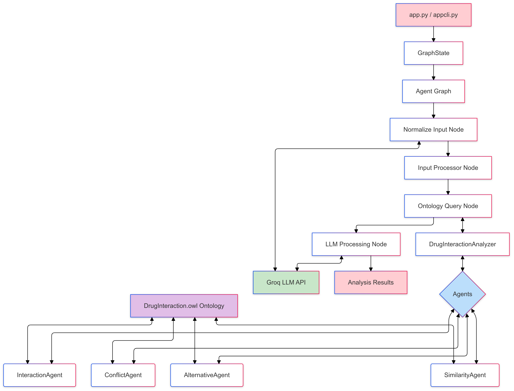

# 🌟 OntoGraph - Drug Interaction Analysis System

A sophisticated Python-based application that combines ontology reasoning with LLM capabilities to analyze drug interactions, conflicts, and alternatives. The system provides comprehensive analysis through both CLI and web interfaces.


## 🚀 Key Features

- Dual Interface Options:
  - Web-based interface using Streamlit
  - Command-line interface for direct interaction
- Comprehensive Drug Analysis:
  - Drug interaction detection
  - Conflict identification
  - Similar drug suggestions
  - Alternative medication recommendations
- Advanced Technology Stack:
  - RDF/OWL ontology for knowledge representation
  - Groq LLM integration for natural language processing
  - Agent-based architecture using Langgraph for modular analysis
  - Structured logging system

## 🛠️ Technical Requirements

- Python 3.x
- Groq API key
- Required Python packages:
  - rdflib
  - langchain
  - python-dotenv
  - langchain-community
  - langchain-groq
  - langgraph
  - streamlit

## 📥 Installation

1. Clone the repository:
```bash
git clone https://github.com/Manithj/onto_graph.git
cd onto_graph
```

2. Install dependencies:
```bash
pip install -r requirements.txt
```

3. Configure environment:
   - Create a `.env` file in the project root
   - Add your Groq API key:
```bash
GROQ_API_KEY=your_api_key_here
```

## 💻 Usage

### Web Interface
```bash
streamlit run app.py
```
Navigate to the displayed local URL to access the web interface.

### Command Line Interface
```bash
python appcli.py
```

## 🏗️ Project Structure

```
onto_graph/
├── app.py              # Streamlit web interface
├── appcli.py          # Command line interface
├── agents/            # Agent implementations
│   ├── __init__.py
│   ├── alternative_agent.py
│   ├── base_agent.py
│   ├── conflict_agent.py
│   ├── interaction_agent.py
│   └── similarity_agent.py
├── analyzers/         # Analysis coordination
│   ├── __init__.py
│   └── drug_interaction_analyzer.py
├── ontology/         # Knowledge base
│   └── DrugInteraction.owl
└── requirements.txt  # Project dependencies
```

## 🔍 Features in Detail

### Agent System
- **Base Agent**: Common functionality for ontology queries
- **Alternative Agent**: Identifies alternative medications
- **Similarity Agent**: Finds similar drugs
- **Conflict Agent**: Detects drug conflicts
- **Interaction Agent**: Analyzes drug interactions

### Analysis Pipeline
1. User input processing
2. Ontology querying
3. LLM-powered result synthesis
4. Structured response generation

## 🤝 Contributing

We welcome contributions! Please follow these steps:

1. Fork the repository
2. Create a feature branch
3. Commit your changes
4. Push to your branch
5. Create a Pull Request

## 📝 Logging

The system maintains detailed logs in `app.log`, capturing:
- Information level messages
- Warning and error states
- Query execution details
- System state changes

## 📜 License

This project is licensed under the [Apache 2.0](LICENSE).
